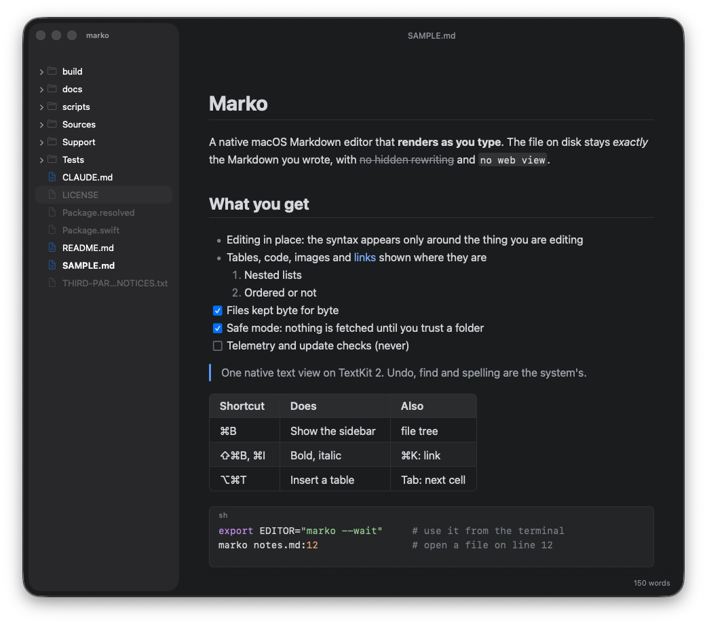

# Marko

A native macOS Markdown editor that renders as you type. Headings, lists, tables, code and
images show in place, and the Markdown syntax appears only around the thing you are editing. The
file on disk is always exactly the Markdown you typed: opening and saving never rewrite it.



Marko is a young app, for macOS 26 on Apple silicon only. Its [known limits](#known-limits) are
listed below.

## Features

- Editing in place on TextKit 2: one native text view, no web view. Undo, find, spelling and
  input methods are the system's.
- Headings, emphasis, links, images, lists and task lists, quotes, code blocks with simple
  colouring, rules, and GitHub Flavored Markdown tables that wrap the text of their cells.
- Files are kept byte for byte: line endings, byte order mark and anything Marko does not render
  (raw HTML, front matter, footnotes) stay as they are.
- Single files and folders, with a file tree in a sidebar; documents save themselves.
- A `marko` command for the terminal, usable as `$EDITOR` with `--wait`.
- Safe mode: nothing is fetched from the network for a document until you trust its folder. No
  telemetry and no update check.
- Light and dark appearance, zoom, window tabs, full screen.

## Install

1. Download `Marko-<version>-macos-arm64.zip` from the
   [releases page](https://github.com/Den1al/marko/releases).
2. Unzip it and move `Marko.app` to `/Applications`.
3. Open it. Marko is not notarized by Apple, so the first time macOS refuses: go to
   System Settings > Privacy & Security and choose **Open Anyway** next to the message about
   Marko. This is needed once.

If you prefer the terminal, this does the same as step 3 before the first start:

```sh
xattr -dr com.apple.quarantine /Applications/Marko.app
```

The `.sha256` file beside the download is its checksum (`shasum -a 256 -c <file>.sha256`). From
the release after 0.1.0 on, `gh attestation verify <file>.zip --repo Den1al/marko` checks that
the download was built by this repository's release workflow.

**The `marko` command.** Choose **Marko > Install Command Line Tool…** in the app, or run the
script inside it:

```sh
/Applications/Marko.app/Contents/Resources/install-cli.sh         # into ~/.local/bin or /usr/local/bin
/Applications/Marko.app/Contents/Resources/install-cli.sh ~/bin   # or into a folder of your choice
```

Without a folder it takes the first of `~/.local/bin` and `/usr/local/bin` that exists, can be
written and is on your `PATH`; if neither is on it, the first that exists and can be written
(it then tells you to add it to your `PATH`). A link that already points into another Marko.app
is re-pointed; a `marko` that is something else is left alone. The link points into the app, so
install it again after moving the app.

**Default app for Markdown.** Marko declares itself an editor for `.md` and `.markdown` files
and accepts folders dropped on its icon, but macOS keeps whatever app already opens `.md`. To
change it: select a `.md` file in the Finder, File > Get Info, "Open with", choose Marko, Change
All…. The app must have been opened once so that the system knows it.

**Update.** Quit Marko and replace the app with the new release. There is no update check.
`marko` talks to whichever Marko is running, and `marko --version` tells the version of the app
the link points into, not of the one that is running.

**Uninstall.**

```sh
/Applications/Marko.app/Contents/Resources/install-cli.sh --uninstall   # removes the marko link
rm -rf /Applications/Marko.app
defaults delete local.marko          # settings, trusted folders, window positions
rm -rf ~/Library/Caches/local.marko ~/Library/HTTPStorages/local.marko
```

`--uninstall` with a folder removes the link there; it only removes a link that points into a
Marko.app. Also left behind, harmless: Marko's recent-documents list
(`~/Library/Application Support/com.apple.sharedfilelist/com.apple.LSSharedFileList.ApplicationRecentDocuments/local.marko.sfl4`)
and, in the folder `getconf DARWIN_USER_TEMP_DIR` prints, `local.marko.savedState`,
`local.marko.socket` with its `.lock` and `.launch` files, and unsaved untitled documents under
`Autosave Information`.

## Build from source

Building needs Swift 6.4 (Xcode 27), from Xcode or the command line tools. It is built and tested
with Swift 6.4.2; Swift 6.3 does not compile it.

```sh
scripts/build-app.sh                                                      # makes build/Marko.app (release)
rm -rf /Applications/Marko.app && cp -R build/Marko.app /Applications/    # installs it; quit Marko first
```

The first build takes under a minute. Every build deletes `build/Marko.app` and makes it again,
and a Marko left running across a rebuild is still the old one until it is quit. A build is
signed ad hoc, like the releases.

`scripts/install-cli.sh` in the repository always links the tool inside `build/Marko.app`. That
is fine for trying things out, but each build deletes that bundle, so the command is missing
for the moment the bundle is assembled, and stays missing if that assembly fails (a compile
error leaves the old one).

Tests, the smoke script and everything else a contributor needs are in
[docs/development.md](docs/development.md).

## Usage

```
marko                 bring Marko to the front, starting it if need be
marko notes.md        open a file; one that does not exist yet is made when it is first saved
marko notes.md:12     open it with the caret on line 12 (also: marko +12 notes.md)
marko folder          open a folder: the file tree, and no file until one is chosen
marko a.md b.md docs  several at once
marko -               open what is piped in as a new document
marko -- *            everything after -- is a file, whatever it is called
```

| Option | |
|---|---|
| `-w`, `--wait` | return only when the documents have been closed |
| `-n`, `--new-window` | always open a new window: not in an empty one, not the folder's own |
| `--trust` | trust the folders named without being asked; the files named load their remote images until Marko quits |
| `--safe` | open the folders named in safe mode without being asked, and stop trusting them; the files named load no remote images |
| `-h`, `--help`; `-v`, `--version` | the usage; the version |

`marko --help` is the reference. Short options combine (`-wn`), `~` is expanded, and a column in
`notes.md:12:5` is accepted and ignored. Paths are taken relative to the folder you are in. If
Marko is running, it opens them; if not, it is started. A file that is already open comes to the
front instead of opening twice.

The command returns as soon as Marko has read the files, which is when it knows whether they
can be opened; their windows appear a moment later. A script that needs the window, or the
text when you are done with it, uses `--wait`:

```sh
export EDITOR="marko --wait"
git config --global core.editor "marko --wait"
```

Exit status: 0 when everything was opened; 1 when something could not be (the reason is
printed), when Marko could not be started or went away before it answered (or, with `--wait`,
before the documents were closed), when piped text is not UTF-8, and for `--trust` on a folder
that cannot be trusted (it is opened in safe mode all the same); 2 for a wrong option, including
`--trust` together with `--safe` or with nothing to open.

## How it behaves

**Saving.** Documents save themselves: edits are written to the file as you go, when you leave a
file for another one and when you quit. File > Save… names an untitled document; holding Option
turns Duplicate into Save As…; Revert To Saved and Browse All Versions… are the system's.

**Folders.** A folder opens with its tree and no file: the page shows the folder's name until
you choose a file in the tree (arrow keys and Return, or a click). ⌘N there starts a new untitled
note in that window; moving the window's file to the Trash brings the empty page back. While the
window shows no file, a file of that folder that you open another way (`marko folder/notes.md`,
Open, the Finder) is shown in it too.

**The empty window.** An empty untitled window (never saved, nothing typed) is not left behind:
when it is the front window, the file or folder you open next, by any way, takes its place. An
untitled document with text is never replaced, and `--new-window` always makes a new window.

**The sidebar.** The arrow keys move through the tree, Return opens a file and Escape goes back
to the text. A right click offers New File, New Folder, Rename, Move to Trash, Copy Path, Copy
Relative Path (from the folder the tree shows) and Reveal in Finder; on the empty area below the
rows the commands are about the folder itself. A row can be dragged out: onto a terminal, which
types the file's path; onto the Finder or another app, which gets a copy of the file or a link to
it (a drag never moves or deletes it); and onto the text, where it becomes a link (an image for
an image file). A file you leave for another one comes back with its caret and scroll position.
Names that start with a dot, `node_modules` and editor backups are not listed.

**Changes from outside.** When another program rewrites the file that is open, Marko shows the
new text where you were, as long as you have no unsaved changes of your own; if you have, your
text stays and saving asks which to keep. A file that is moved is followed. A file that is
deleted leaves its text in the window, and the next save makes the file again.

**Windows.** The windows that are open when you quit come back at the next start, unless "Close
windows when quitting an application" is switched on in System Settings.

**Settings.** There is no settings window. The View menu holds what can be set, and it is
remembered: Zoom, Full Width (the text column follows the window instead of keeping to a
readable width), Hide/Show Word Count, the sidebar's width. They and the trusted folders are in
the `local.marko` defaults (`defaults read local.marko`).

## Shortcuts

| | |
|---|---|
| Show or hide the sidebar | ⌘B |
| Bold, Italic | ⇧⌘B, ⌘I |
| Strikethrough, Inline Code | ⇧⌘X, ⇧⌘C |
| Link, Image | ⌘K, ⇧⌘I |
| Heading 1–6, Paragraph | ⌘1–⌘6, ⌘0 |
| Heading level up, down | ⌃⌘=, ⌃⌘- |
| Bullet, Ordered, Task List | ⌥⌘U, ⌥⌘O, ⌥⌘X |
| Quote, Code Block, Horizontal Rule | ⌥⌘B, ⌥⌘C, ⌥⌘- |
| Insert Table | ⌥⌘T |
| Next, previous table cell | Tab, ⇧Tab |
| Nest a list item, move it out | Tab, ⇧Tab |
| Indent code, take the indent off | Tab, ⇧Tab |
| Zoom in, out, actual size | ⌘+, ⌘-, ⌃⌘0 |
| Find, Find and Replace | ⌘F, ⌥⌘F |
| Next, previous window tab; all tabs | ⌃Tab, ⌃⇧Tab; ⇧⌘\ |
| Full screen | ⌃⌘F |
| Open a link | ⌘-click |

In a code block, Return keeps the indentation of the line before (one level deeper after an open
bracket or, in Python and the like, a colon). The exact rules for lists and code are in
[docs/known-limits.md](docs/known-limits.md#editing-rules-in-detail).

## Security

Marko is not sandboxed: it runs with your rights. What it does on behalf of a document is kept
small, and everything opens in **safe mode** until you say otherwise.

- **Safe mode** means nothing is fetched from the network for a document: images on the web or
  on a network volume show a "Remote image blocked" placeholder. Everything else works the same:
  editing, saving, local images, links. A small shield beside the word count marks it.
- **The question.** A folder you open for the first time asks once: **Open in Safe Mode** (the
  default; Return and Escape) or **Trust Folder**. Trusting does one thing: documents in that
  folder and below may load the images they link to on the web, which tells those servers that
  you opened the document. The answer is remembered.
- **Changing it.** File > Trust This Folder… / Stop Trusting This Folder, File > Trusted
  Folders, or `marko --trust folder` / `marko --safe folder`. View > Load Remote Images, or a
  click on a blocked image, loads them for one document until Marko quits.
- **Never trusted:** the disk, top-level folders, your home folder, the temporary folder.
- **Links and files.** ⌘-click opens web and mail addresses in your browser and Markdown files in
  Marko; any other linked file is shown in the Finder, never opened. A double click in the
  sidebar opens only pictures, sound, film, PDF and plain text.
- **Never:** no update check, no telemetry, no link previews, no web view, nothing a document
  names is run. The only network request is the one for a remote image of a trusted document;
  it keeps and sends no cookies and leaves no copy of the image on disk.

The full text, with every case: [docs/security.md](docs/security.md).

## Known limits

- **Tables** written without the outer pipes, or with a row that has too many cells, show as
  their Markdown source; so does a table with more columns than the page has room for (16 in a
  window of the default size). A table too wide for the page wraps the text of its cells.
  Images in cells show as source.
- **Shown as source, never rendered:** raw HTML, footnotes, front matter, math, diagrams and link
  reference definitions. They are kept byte for byte.
- **Copy** gives the Markdown source. There is no export.
- **Files** must be UTF-8; anything else is refused rather than rewritten.
- **Undo** ends when you switch files in the sidebar, and when a file is loaded again after
  another program changed it.
- **Lists.** Markers are never shown as text (`-` cannot be changed to `*` in place) and ordered
  lists are not renumbered.
- **Find** is the system find bar, on the Markdown source; no regular expressions.
- **Code** is coloured by a small generic tokenizer, not per-language grammars.
- **Large documents** (from a few hundred KB): the scroller's knob jumps while scrolling.
- **Untested:** VoiceOver (it reads the raw Markdown), Chinese, Japanese and Korean input
  methods, the press-and-hold accent popup, right-to-left text.
- **Distribution.** Releases and `build/Marko.app` are signed ad hoc and not notarized; on a Mac
  that downloaded the app, Gatekeeper refuses it until you allow it ([Install](#install)).

The complete list: [docs/known-limits.md](docs/known-limits.md).

## Troubleshooting

| What you see | Cause and fix |
|---|---|
| `marko: command not found`, or "no such file or directory" | The link is missing or points at an app that moved or was deleted (a link into `build/` breaks during a build). Install the link again from the app you use. |
| `... is not on your PATH; add it to use "marko" by name.` | The link was made; add that folder to your `PATH`. |
| `install-cli: ... points to ..., which is not Marko's; left alone.` | Another program named `marko` owns the name (the Python package, for one). Remove it or install into another folder. |
| `marko: Marko did not start` | The app did not listen within 20 seconds. Open the app once by hand; a downloaded copy that Gatekeeper has not been told to allow does not start ([Install](#install)). |
| `marko: Marko went away before it answered` / `while waiting` | The app quit. The tool exits 1, so git gives up the commit instead of taking a half-written message. |
| `--trust is also the name of a file here` | The shell expanded `*` to a file of that name. Use `marko -- *`. |
| Nothing changed after a rebuild | The old Marko is still running. Quit it. |
| Images show "Remote image blocked" | Safe mode. Click the placeholder, choose View > Load Remote Images, or trust the folder. |
| Double-clicking a `.md` opens another app | See "Default app for Markdown" above. |
| A file is refused as "not UTF-8 text" | Convert it to UTF-8; Marko does not guess encodings. |

## Licence

Created by [Daniel Abeles](https://github.com/Den1al). Marko is released under the MIT License:
see [LICENSE](LICENSE).

Marko links [swift-markdown](https://github.com/swiftlang/swift-markdown) (Apache License 2.0)
and, through it, [swift-cmark](https://github.com/swiftlang/swift-cmark) (BSD 2-Clause, with parts
under the MIT licence). Their licence texts and notices are in
[THIRD-PARTY-NOTICES.txt](THIRD-PARTY-NOTICES.txt), which `scripts/build-app.sh` copies into
`Marko.app/Contents/Resources`, so they go wherever the app goes.

## More

- [SAMPLE.md](SAMPLE.md) – the document in the picture above; open it to try Marko.
- [docs/README.md](docs/README.md) – what each document is and when to read it.
- [docs/development.md](docs/development.md) – building, testing, running the app safely.
- [docs/architecture.md](docs/architecture.md) – how it works.
- [CLAUDE.md](CLAUDE.md) – the short rules for working in this repository, for people and coding agents.
